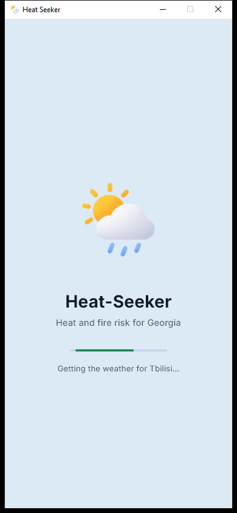
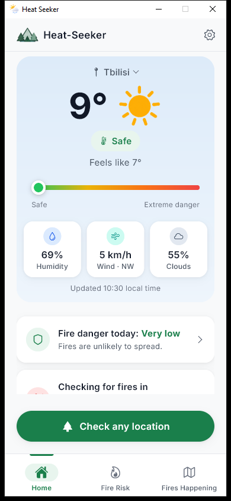
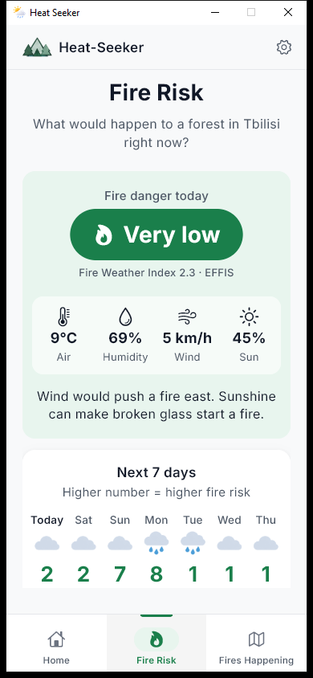
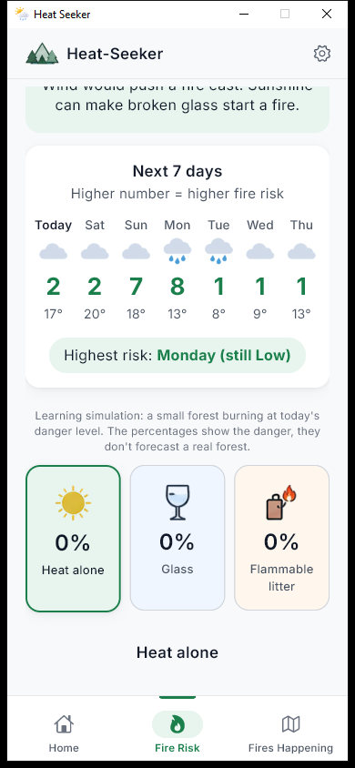
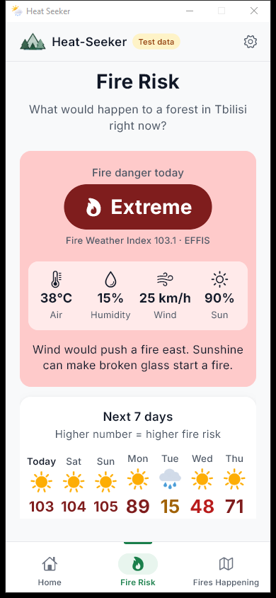
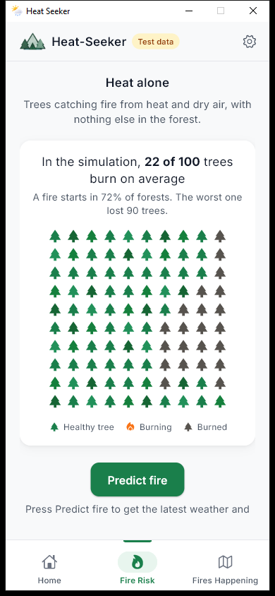
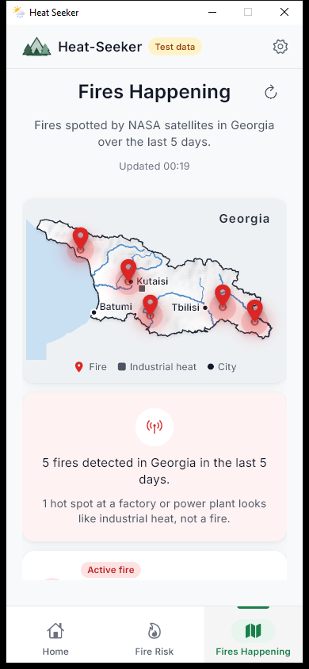
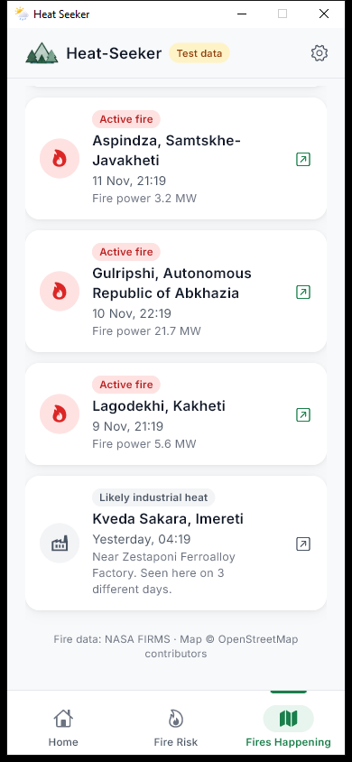
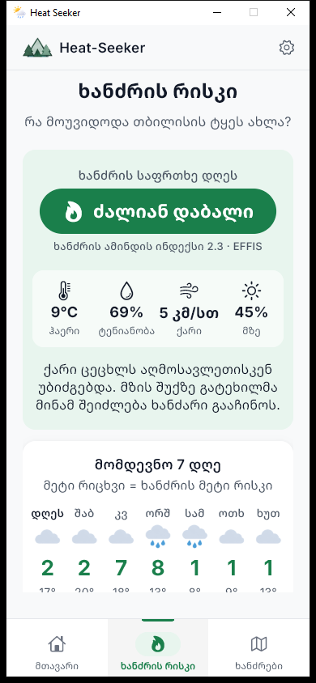
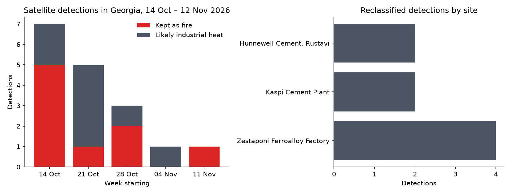

# Heat-Seeker

A Python-based application that combines a **Heat Risk Checker** and a **Fire Spread Simulator** to analyze weather conditions and simulate how wildfires spread.

It is built with [Flet](https://flet.dev), so the same code runs as a **Windows desktop app** and as an **Android app (APK)**. For any place in Georgia it shows the live weather and heat risk, rates today's **fire danger with the Canadian Fire Weather Index** (the system EFFIS uses across Europe and the Caucasus), forecasts it for the **next 7 days**, and maps the fires NASA satellites have spotted in Georgia over the last 5 days, in **English and Georgian**.

---

## Screenshots

<table>
  <tr>
    <td align="center"><br><b>Loading screen</b></td>
    <td align="center"><br><b>Home</b> (live weather)</td>
    <td align="center"><br><b>Fire Risk</b> (live)</td>
  </tr>
  <tr>
    <td align="center"><br><b>7-day forecast</b> (live)</td>
    <td align="center"><br><b>Fire Risk</b> on an extreme day*</td>
    <td align="center"><br><b>Learning simulation</b>*</td>
  </tr>
  <tr>
    <td align="center"><br><b>Fires Happening</b>*</td>
    <td align="center"><br><b>Fire list</b>*</td>
    <td align="center"><br><b>Georgian</b> (live)</td>
  </tr>
</table>

\* Taken in test mode (see [Test Mode](#test-mode)) with made-up weather (38 °C, 15% humidity, 25 km/h wind, 40 dry days) and sample fires, to show the app when the danger is high. The amber **Test data** tag marks these.

---

## Features

### Home
- **Live weather** for Tbilisi or any town in Georgia (Open-Meteo): temperature, humidity, wind and cloud cover, with a weather picture that follows the sky (sun, night, cloud, rain, snow, wind).
- **Heat risk** as a coloured pill under the temperature (Safe, Caution, Extreme caution, Danger, Extreme danger), from the NOAA Heat Index, plus a "feels like" temperature and a green-to-red meter.
- **Today's fire danger** and the **number of fires in Georgia**, as cards that open the other screens.
- **Check any location**: search any town or village in Georgia (only Georgia), or pick one of 8 cities.
- **Check any temperature**: a heat index calculator for any temperature and humidity.

### Fire Risk
- **Fire danger today** from the **Canadian Fire Weather Index (FWI)**, shown as a large badge in a traffic-light colour: green = safe, yellow = caution, red = danger. The FWI value is shown under it.
- **Today's weather** as four big icons (air temperature, humidity, wind, sunshine) and two plain sentences on which way a fire would spread and whether broken glass could start one.
- **Next 7 days**: a weather picture, the FWI number in its danger colour and the top temperature for each day, and a chip naming the riskiest day ("Highest risk: Monday (still Low)").
- **Learning simulation**: three cases (*heat alone*, *broken glass*, *flammable litter*), each simulated on 300 small forests burning at today's FWI. Clearly labelled as a picture of the danger level, not a forecast of a real forest.
- **Predict fire**: fetches the latest weather, lights a fire in a 10×10 forest and animates it spreading with the real wind.
- Built to be **easy to read**, including for older people: large text, big numbers, short sentences.
- The weather and the danger **update by themselves every 15 minutes**.

### Fires Happening
- **A map of Georgia** with the real Black Sea coastline, terrain shading, the six main rivers, city dots and a legend.
- **Red pins** for fires detected by NASA's VIIRS NOAA-21 satellite in the last 5 days, sized by fire power, checked against OpenStreetMap so only fires **inside Georgia** are shown.
- **A list of fires** with place name, time (Georgian time) and fire power, each with a Google Maps link.
- **Likely industrial heat**: satellites can't tell a steel plant from a fire. A hot spot within 2 km of a known heat-producing site that was also seen on another day in the last 15 days is shown as a grey square and not counted as a fire (see [Validation](#validation-of-the-industrial-heat-filter)).

### Everywhere
- **English and Georgian**, switched in Settings and remembered between launches, together with °C/°F.
- **Custom loading screen**: the phone's splash screen, a startup screen and an in-app loading screen.
- **Mobile-first design** with Inter and Noto Sans Georgian fonts; on phones the header and tab bar stay clear of the status and navigation bars.

---

## How the Fire Danger Is Calculated

The danger rating is the **Canadian Forest Fire Weather Index (FWI) System** ([Van Wagner, 1987](https://cfs.nrcan.gc.ca/publications?id=19927)), the system used by Canada and by [EFFIS](https://forest-fire.emergency.copernicus.eu/), the European Forest Fire Information System, which covers Georgia. It is implemented in [`Application/core/fwi.py`](Application/core/fwi.py).

From each day's **noon temperature, humidity, wind and 24-hour rain** it tracks how dry the forest is:

| Code | What it measures | Reacts within |
|---|---|---|
| FFMC | Fine Fuel Moisture Code: dryness of litter and fine fuels | hours |
| DMC | Duff Moisture Code: dryness of the loose organic layer | weeks |
| DC | Drought Code: dryness of deep organic layers | months |
| ISI | Initial Spread Index: how fast a fire would spread (FFMC + wind) | |
| BUI | Buildup Index: how much fuel is available (DMC + DC) | |
| **FWI** | **Fire Weather Index: overall fire danger (ISI + BUI)** | |

Because DMC and DC remember weeks of weather, the app downloads the **last ~2 months** of noon weather plus the **7-day forecast** from Open-Meteo and runs the index day by day. The FWI is then grouped into the **EFFIS danger classes**:

| FWI | Danger | Colour in the app |
|---|---|---|
| below 5.2 | Very low | green |
| 5.2 – 11.2 | Low | green |
| 11.2 – 21.3 | Moderate | yellow |
| 21.3 – 38 | High | red |
| 38 – 50 | Very high | darker red |
| 50 and above | Extreme | darkest red |

The implementation reproduces the **published test values** of the FWI System (Van Wagner & Pickett, 1985) exactly, for all six numbers (see [Testing](#testing)).

---

## Testing

The tests use [pytest](https://pytest.org) and need no internet or API key:

```bash
pip install -r requirements-dev.txt
```

```bash
python -m pytest tests
```

**202 checks** in `tests/`:

| File | What it checks |
|---|---|
| `test_fwi.py` | FWI against the published test data (Van Wagner & Pickett 1985), EFFIS class boundaries, rain and drought behaviour |
| `test_heat.py` | Heat Index against 9 values from the NOAA heat index chart, and the heat risk levels |
| `test_fire_sim.py` | wind direction, fire spreading only to neighbours, fires always burning out, a higher FWI burning more |
| `test_nasa_firms.py` | distances, the industrial-site check, `days_seen`, and the Georgia filter (with the network faked) |
| `test_day_icons.py` | which weather picture each forecast day gets |
| `test_translations.py` | every text exists in English and Georgian and fills in the same values |

---

## Validation of the Industrial Heat Filter

[`validation/validate_industrial_filter.py`](validation/validate_industrial_filter.py) applies the app's rule to one month of real NASA FIRMS data (14 Oct – 12 Nov 2026) and checks the result against satellite imagery. Full write-up: **[validation/REPORT.md](validation/REPORT.md)**.

- **17** satellite detections inside Georgia; **8 (47%)** were heat from three industrial plants (Zestaponi ferroalloy ×4, Rustavi cement ×2, Kaspi cement ×2) and were all reclassified.
- **All 8** industrial detections were made **at night**, against 22% of the fires. The rule never looks at the time of day, so this is independent support.
- On satellite images, **3 of 3** reclassified places are industrial plants and **4 of 4** of the strongest detections kept as fires are on farmland.



---

## New Design - V-5


---

## How to Set It Up

**1. Clone the repository**

```bash
git clone https://github.com/ydwagz/Heat-Seeker.git
```

**2. Create a virtual environment**

```bash
py -m venv env
```

**3. Activate the virtual environment**

```bash
env\Scripts\activate
```

**4. Install the required dependencies**

```bash
pip install -r requirements.txt
```

`os`, `csv` and `json` are part of Python's standard library, so they do not need to be installed separately.

**5. Add your NASA FIRMS key**

The Fires Happening screen needs a free NASA FIRMS map key ([request one here](https://firms.modaps.eosdis.nasa.gov/api/map_key/)). Create a file called `.env` in the `Application` folder with:

```bash
FIRMS_KEY=your_key_here
```

`.env` is listed in `.gitignore`, so the key is never committed.

---

## Running the App

### On the computer

```bash
cd Application
```

```bash
python main.py
```

The app opens in a phone-sized window. Use the Python from the virtual environment; the system Python doesn't have Flet installed.

### On a phone, live from the computer

Install the **Flet** app from Google Play or the App Store, connect the phone and the computer to the same Wi-Fi, then run:

```bash
cd Application
```

```bash
flet run --android
```

Scan the QR code with the Flet app. Changes to the code reload on the phone as soon as they are saved. (Use `--ios` for an iPhone.)

### As an Android app (APK)

Run **`scripts\build_apk.bat`** (double-click it, or run it from a terminal). It runs `flet build apk` and works behind antivirus HTTPS scanning. The build tools (Flutter, Java, Android SDK, about 8–10 GB) are kept in `E:\FletTools`; to use another folder, set it first, for example `set FLET_TOOLS=D:\FletTools`. The first build takes 15–30 minutes; later builds take a few minutes.

```bash
scripts\build_apk.bat --arch arm64-v8a
```

builds a smaller APK (about 60 MB) for 64-bit phones, nearly every Android phone from the last 6–7 years. The APK is saved in `Application\build\apk\`. Copy it to the phone, open it and allow "Install unknown apps". The app's name, version, icon, splash screen and startup screen are set in `Application\pyproject.toml`.

---

## Test Mode

`Application/Testing.py` lets you try the app with made-up data instead of live data:

```python
TESTING = True   # False = live weather and live NASA fires
TEMPERATURE_C = 38
HUMIDITY = 15
WIND_SPEED_KMH = 25
WIND_FROM = "W"
SKY = "clear"          # clear, cloudy, fog, rain, snow, storm
DRY_DAYS_BEFORE = 40   # rain-free days before today, for the Fire Weather Index
FORECAST = [...]       # today and 6 more days: (temperature change, humidity change, rain mm)
FIRES = [
    (42.272, 42.625, 2, 14.0, "Kutaisi", "Imereti"),  # latitude, longitude, hours ago, fire power (MW), place, region
    ...
]
SEEN_BEFORE = [...]    # earlier detections, for testing the "Likely industrial heat" label
```

While test mode is on, a **Test data** tag is shown next to the logo, so test values are never mistaken for real ones.

---

## Project Structure

```
Heat-Seeker/
├── Application/                The app
│   ├── main.py                 Interface: screens, map, loading screen, settings (start here)
│   ├── translations.py         All interface text in English and Georgian
│   ├── Testing.py              Test mode values
│   ├── pyproject.toml          Android build settings (name, version, icon, splash)
│   ├── .env                    FIRMS_KEY (not committed)
│   ├── core/                   The science and data, separate from the interface
│   │   ├── heat.py             Heat Index, live weather, 7-day forecast, place search (Open-Meteo)
│   │   ├── fwi.py              Canadian Fire Weather Index System and EFFIS danger classes
│   │   ├── fire_sim.py         Learning simulation of a forest fire, driven by the FWI
│   │   └── nasa_firms.py       NASA FIRMS fires, Georgia filter, industrial heat check
│   ├── data/
│   │   ├── georgia_outline.json     Georgia's border and coastline
│   │   ├── georgia_rivers.json      Main rivers
│   │   ├── georgia_elevation.json   Terrain heights for the map shading
│   │   └── industrial_sites.json    Factories and power plants for the industrial heat check
│   └── assets/
│       ├── icon.png, splash.png     App icon and splash screen
│       ├── brand/                   Logo mark and window icon
│       ├── weather/                 Weather pictures
│       ├── forest/                  Sun, glass and litter pictures for the simulation
│       └── fonts/                   Inter and Noto Sans Georgian (with licences)
├── tests/                      Unit tests (pytest)
├── validation/                 Industrial heat filter study: script, results, REPORT.md
├── scripts/build_apk.bat       Builds the Android APK
├── docs/
│   ├── screenshots/            Screenshots used in this README
│   └── design/                 Original artwork: design mock-up, icon and logo sources
├── requirements.txt            Packages the app needs
└── requirements-dev.txt        Extra tools for the tests and the validation chart
```

---

## Data Sources and Credits

| What | Source |
|---|---|
| Weather, 7-day forecast, place search | [Open-Meteo](https://open-meteo.com) forecast and geocoding APIs |
| Fire danger method | Canadian Forest Fire Weather Index System (Van Wagner 1987), danger classes of [EFFIS](https://forest-fire.emergency.copernicus.eu/) |
| Fires | [NASA FIRMS](https://firms.modaps.eosdis.nasa.gov), VIIRS NOAA-21 near-real-time data |
| Place names for fires | [Nominatim](https://nominatim.openstreetmap.org) (OpenStreetMap) |
| Map outline, coastline, rivers, industrial sites | © [OpenStreetMap](https://www.openstreetmap.org/copyright) contributors, ODbL |
| Terrain heights | Copernicus DEM GLO-90, via the Open-Meteo elevation API |
| Satellite images in the validation study | Esri World Imagery (Esri, Maxar, Earthstar Geographics) |
| Fonts | [Inter](https://rsms.me/inter/) and [Noto Sans Georgian](https://github.com/notofonts/georgian), SIL Open Font License |

---

# Original Code (Without the App)

## Heat Risk Checker

```python
import requests

def heat_risk_checker(T: float, RH: float):
    temp_c = T
    temp_f = temp_c * 9/5 + 32

    c_1 = -42.379
    c_2 = 2.04901523
    c_3 = 10.14333127
    c_4 = -0.22475541
    c_5 = -0.00683783
    c_6 = -0.05481717
    c_7 = 0.00122874
    c_8 = 0.00085282
    c_9 = -0.00000199

    hi = 0.5 * (temp_f + 61 + (temp_f - 68) * 1.2 + RH * 0.094)

    if hi >= 80:
        hi = c_1 + c_2 * temp_f + c_3 * RH  + c_4 * temp_f * (RH) + c_5 * temp_f**2 + c_6 * (RH)**2 + c_7 * temp_f**2 * (RH) + c_8 * temp_f * (RH)**2 + c_9 * temp_f**2 * (RH)**2  
        

    hi_c  = (hi - 32) / 9*5 

    if hi < 80:
        print("Safe")
    elif hi < 90:
        print('Caution')
    elif hi < 103:
        print("Extreme Caution")
    elif hi < 125:
        print("Danger")
    else:
        print("Extreme Danger")

    return f"F: {hi} \nC: {hi_c}"

response = requests.get("https://api.open-meteo.com/v1/forecast?latitude=41.72&longitude=44.79&current=temperature_2m,relative_humidity_2m")
data = response.json()  
current = data["current"]

print(f'time: {current["time"]}')
print(f'Temperature: {current["temperature_2m"]} C')
print(f'Humidity: {current["relative_humidity_2m"]} %')

idx = heat_risk_checker(current["temperature_2m"], current["relative_humidity_2m"])
print(idx)
```

### How It Works

It gets Georgia's temperature and humidity from an API, then calculates the Heat Index using a formula.

**Code by Luca Godadze.**

**API Used:**

https://api.open-meteo.com/v1/forecast?latitude=41.72&longitude=44.79&current=temperature_2m,relative_humidity_2m

---

## Fire Spread Simulator

```python
import random
import time

grid = []
Left_Trees = 0
grid_size = 10

for _ in range(grid_size):
    grid.append(["🌲"] * grid_size)
    
grid[4][4] = "🔥"

def get_neighbors(grid, row, col):
    neighbors = []
    up = row - 1, col
    down = row + 1, col
    left = row, col - 1
    right = row, col + 1

    candidates = [up, down, left, right]

    for r, c in candidates:
        if 0 <= r < len(grid) and 0 <= c < len(grid):
            neighbors.append((r, c))
            

    return neighbors

def spread(grid, wind):
    opposite = {"east": "west", "west": "east", "north": "south", "south": "north"}
    to_ignite = []
    to_burn_out = []
    
    for r in range(len(grid)):
        for c in range(len(grid)):

            if grid[r][c] == "🔥":
                to_burn_out.append((r, c))
                
                for nr, nc in get_neighbors(grid, r, c):
                    if grid[nr][nc] == "🌲":
                        if nc > c:
                            direction = "east"
                        elif nc < c:
                            direction = "west"
                        elif nr < r:
                            direction = "north"
                        else:
                            direction = "south"

                        if direction == wind:
                            chance = 0.9
                        elif direction == opposite[wind]:
                            chance = 0.1
                        else:
                            chance = 0.4

                        if random.random() < chance:
                            to_ignite.append((nr, nc)) 
                        

    for r, c in to_burn_out:                     
        grid[r][c] = "⚫" 
    for r, c in to_ignite:              
        grid[r][c] = "🔥"  

def has_fire(grid):
    global Left_Trees
    
    for r in range(len(grid)):
        for c in range(len(grid)):
            if grid[r][c] == "🔥":
                return True   
    for r in range(len(grid)):
        for c in range(len(grid)):     
            if grid[r][c] == "🌲":
                Left_Trees += 1
    
    return False  

def print_grid(grid):
    time.sleep(0.2)
    for row in grid:
        print("  ".join(row))
    print("------------------")

has_fire(grid)

while has_fire(grid):
    print_grid(grid)
    spread(grid, "south")
print_grid(grid)

print(f"{Left_Trees} Trees Survived")
```

### How It Works

It creates a 10x10 grid of trees, with a fire in the middle. The fire checks its neighboring trees. Each neighboring tree has a percentage chance of catching fire depending on the wind direction. After each round, the original fire goes out and becomes a burned-out cell. The program then counts and prints how many trees survived.

**Code by Luca Godadze.**

---

## NASA FIRMS

```python
import csv
import os
import time

import requests
import truststore
from dotenv import load_dotenv

truststore.inject_into_ssl()
load_dotenv()

FIRMS_KEY = os.getenv("FIRMS_KEY")
FIRMS_URL = "https://firms.modaps.eosdis.nasa.gov/api/area/csv"
SOURCE = "VIIRS_NOAA21_NRT"
DAYS = 5
GEORGIA_BBOX = "39.9,41.0,46.8,43.6"
COUNTRY_CODE = "ge"

NOMINATIM_URL = "https://nominatim.openstreetmap.org/reverse"
USER_AGENT = "HeatSeeker-student-project"

def fetch_fires(bbox: str = GEORGIA_BBOX, days: int = DAYS) -> list[dict]:
    response = requests.get(f"{FIRMS_URL}/{FIRMS_KEY}/{SOURCE}/{bbox}/{days}", timeout=60)
    response.raise_for_status()
    if not response.text.startswith("latitude"):
        # FIRMS answers errors (bad key, bad area) with plain text and status 200
        raise RuntimeError(f"FIRMS refused the request: {response.text.strip()[:200]}")
    return list(csv.DictReader(response.text.splitlines()))

def look_up_address(lat: str, lon: str) -> dict:
    response = requests.get(
        NOMINATIM_URL,
        params={"lat": lat, "lon": lon, "format": "json", "accept-language": "en"},
        headers={"User-Agent": USER_AGENT},
        timeout=30,
    )
    response.raise_for_status()
    return response.json().get("address", {})

def fires_in_georgia(fires: list[dict]) -> list[dict]:
    addresses = {}
    kept = []
    for fire in fires:
        cell = (round(float(fire["latitude"]), 2), round(float(fire["longitude"]), 2))
        if cell not in addresses:
            addresses[cell] = look_up_address(fire["latitude"], fire["longitude"])
            time.sleep(1)  # Nominatim allows at most 1 request per second
        address = addresses[cell]
        if address.get("country_code") == COUNTRY_CODE:
            kept.append({**fire, "address": address})
    return kept

def place_name(address: dict) -> str:
    settlement = next(
        (address[k] for k in ("village", "town", "city", "hamlet", "municipality", "county") if k in address),
        None,
    )
    region = address.get("state")
    return ", ".join(part for part in (settlement, region) if part) or "Georgia"

def detection_time(fire: dict) -> str:
    hhmm = fire["acq_time"].zfill(4)
    return f"{fire['acq_date']} {hhmm[:2]}:{hhmm[2:]} UTC"

def main():
    if not FIRMS_KEY:
        raise SystemExit("FIRMS_KEY is missing. Add it to Application/.env.")

    fires = fetch_fires()
    georgia = fires_in_georgia(fires)
    skipped = len(fires) - len(georgia)

    print(f"{len(georgia)} fires detected in Georgia in the last {DAYS} days.")
    if skipped:
        print(f"Skipped {skipped} detections just across the border.")

    for fire in sorted(georgia, key=detection_time, reverse=True):
        lat, lon = fire["latitude"], fire["longitude"]
        print()
        print(f"{detection_time(fire)}  {place_name(fire['address'])}")
        print(f"  https://www.google.com/maps?q={lat},{lon}")

if __name__ == "__main__":
    main()

```

## How It Works
The code retrieves data from the NASA FIRMS API (https://firms.modaps.eosdis.nasa.gov/api/). The API provides satellite observations from the VIIRS NOAA-21 NRT source, which detects thermal anomalies and potential fires worldwide. The request uses a bounding box to identify detections around Georgia (Sakartvelo): `GEORGIA_BBOX = "39.9,41.0,46.8,43.6"`.

Because Georgia's borders do not form a rectangle, the code applies additional geographical filtering to keep detections within the country's territory. It then uses location information and Google Maps links to show where the detected hotspots are located. 

For testing purposes, I gave the code a false alarm, and it returned a Google Maps location for the detected fire:


**APIs Used:**

Nominatim: https://nominatim.openstreetmap.org/reverse

Google Maps: https://www.google.com/maps

NASA FIRMS: https://firms.modaps.eosdis.nasa.gov/api/area/csv

## Smart Fire Monitoring & Prevention

The application integrates NASA's FIRMS (Fire Information for Resource Management System) API with Google Maps to monitor wildfire activity across Georgia (Sakartvelo).

The system uses satellite data from VIIRS NOAA-21 NRT, which detects thermal anomalies and potential fire hotspots around the world. NASA FIRMS provides access to these satellite observations, including near-real-time fire data.

The system defines a geographical bounding box around Georgia using the following coordinates:

```python
GEORGIA_BBOX = "39.9,41.0,46.8,43.6"
```

Since Georgia's geographical shape does not follow a simple rectangle, additional geographical filtering is applied to ensure that monitoring focuses specifically on the country's territory.

The detected fire hotspots are shown on the app's own map of Georgia, and each one has a Google Maps link to see exactly where it is.

### Weather-Based Fire Risk Assessment

In addition to satellite monitoring, the application rates how dangerous the weather is for wildfires with the **Canadian Fire Weather Index**, the system used by EFFIS across Europe and the Caucasus (see [How the Fire Danger Is Calculated](#how-the-fire-danger-is-calculated)). For example, a hot, dry and windy day in Tbilisi (38 °C, 15% humidity, 25 km/h wind, after 40 days without rain) gives an FWI above 100: **Extreme** danger.

The learning simulation then shows what that danger level means for a small forest with nothing in it, with broken glass, or with flammable litter. These simulated percentages illustrate the danger level; they are not a forecast of how much real forest would burn.

### CSR – Creating Awareness and Preventing Wildfires

Beyond technology and monitoring, this project has an important Corporate Social Responsibility (CSR) purpose. Our goal is not simply to detect fires after they start, but to help prevent them by educating and engaging the public.

Through the application, we want to raise awareness about two often-overlooked sources of potential fire danger.

#### Glass Waste in Forests

Leaving glass bottles and broken glass in forests is not harmless. Under certain environmental conditions, glass can contribute to fire ignition. Visitors should take all glass waste with them and dispose of it properly.

#### Discarded Cigarette Butts

A cigarette butt thrown into dry grass or forest vegetation can become a source of ignition. We want to encourage smokers to never discard cigarette butts in nature and always use appropriate disposal bins.

### Our Mission

To combine satellite technology, geographical intelligence, weather information, and public awareness into one integrated wildfire monitoring and prevention platform.

**Detect fires. Understand risks. Change behavior. Protect Georgia's forests.**

---

# AI Assistance

The application's design was created with AI assistance (Claude Code Opus 5.5).

AI assistance (Claude Code, Opus 5.5) was also used to build and check the features added after the first versions: the Flet interface and map, the Fire Weather Index implementation and 7-day forecast, the industrial heat filter and its validation study, the unit tests and the Android build. The original Heat Risk Checker and Fire Spread Simulator above were written by hand. Every feature was checked by running the app with live and test data, and the science is checked by the tests against published values (NOAA heat index chart, Van Wagner & Pickett FWI test data).

The application icon was created with ChatGPT by OpenAI.


