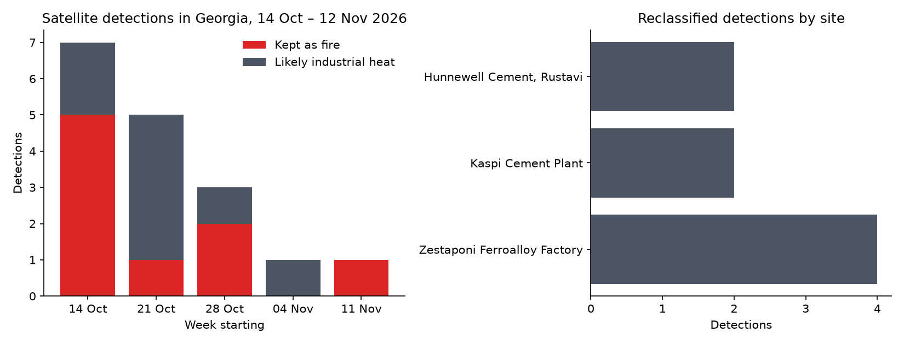
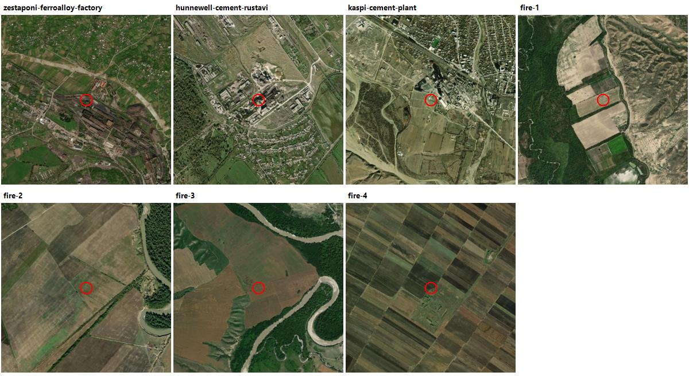

# Validating the "likely industrial heat" filter

Satellites detect heat, not fire. A steel plant, a cement kiln or a gas flare looks the same to them as a burning field, so a fire map built on raw NASA FIRMS data shows false alarms. Heat-Seeker labels a hot spot **likely industrial heat** when both of these hold:

1. it lies within **2 km** of one of 19 known heat-producing sites in and near Georgia (`Application/data/industrial_sites.json`, collected from OpenStreetMap), and
2. a hot spot was detected at the same place (within **1 km**) on **at least 2 different days** in the **15 days** up to and including that day.

This study checks how the rule behaves on one month of real data.

## Method

- **Data:** every NASA FIRMS detection from the VIIRS NOAA-21 near-real-time product in the Georgia box (39.9–46.8° E, 41.0–43.6° N), from 30 Sep to 12 Nov 2026. The study month is **14 Oct – 12 Nov 2026**; the 15 days before it only provide history for the rule.
- **Inside Georgia:** detections are kept if they fall inside Georgia's border (OpenStreetMap outline, point-in-polygon test).
- **Classification:** exactly the rule the app uses, imported from `Application/core/nasa_firms.py`.
- **Checking by eye:** a satellite image (Esri World Imagery, about 2.4 km across) of every place the rule called industrial, and of the four strongest detections it kept as fires.
- **Reproduce:** `env\Scripts\python.exe validation\validate_industrial_filter.py` (needs `FIRMS_KEY` in `Application/.env` and `matplotlib`). Raw results are in `validation/results/`.

## Results

| | Detections |
|---|---:|
| In the Georgia box | 205 |
| Inside Georgia, study month | **17** |
| Kept as fires | 9 |
| Reclassified as likely industrial heat | **8 (47%)** |
| Near a site but kept as fire (seen only once) | 0 |

| Site | Reclassified detections |
|---|---:|
| Zestaponi Ferroalloy Factory | 4 |
| Hunnewell Cement, Rustavi | 2 |
| Kaspi Cement Plant | 2 |

**Independent evidence: time of day.** The rule never looks at whether a detection was made by day or by night, yet **all 8 reclassified detections were made at night**, against **22% of the detections kept as fires**. Vegetation and field fires peak in the afternoon; furnaces and kilns run around the clock. This agrees with the classification.

**Satellite check.** Red circles mark the detection.

- **Reclassified (top row, first three):** all three are clearly industrial: the Zestaponi ferroalloy works (large halls with rust-coloured roofs), the Rustavi cement plant and the Kaspi cement works. **3 of 3 correct.**
- **Kept as fires (fire-1 to fire-4):** all four strongest detections are on farmland in eastern Georgia (Kakheti), mostly fields beside rivers. This matches autumn burning of crop stubble. **4 of 4 correctly kept as fires.**

## Conclusion

In this month, **almost half (8 of 17) of the satellite "fires" in Georgia were heat from three industrial plants**, and the filter removed all of them without removing any field fire. Without it, a user in Zestaponi would have seen a "fire" near their town four times in one month.

## Limitations

- **Small sample.** One month in the low fire season, 17 detections. The study should be repeated for July–August, when there are many more fires and a real fire could burn close to a plant.
- **No ground truth beyond imagery.** Satellite images show what is at the spot, not that it was burning that night. The Esri imagery is also not from the same date.
- **Only sites on the list are caught.** A plant missing from `industrial_sites.json` would still show as a fire. A real fire that burns for 2+ days within 2 km of a listed plant would be labelled industrial (it is still shown on the map, in grey).
- **One satellite.** Only VIIRS on NOAA-21 is used; adding NOAA-20 and MODIS would give more detections per day.

Satellite imagery: Esri, Maxar, Earthstar Geographics. Fire data: NASA FIRMS. Map data: © OpenStreetMap contributors (ODbL).
